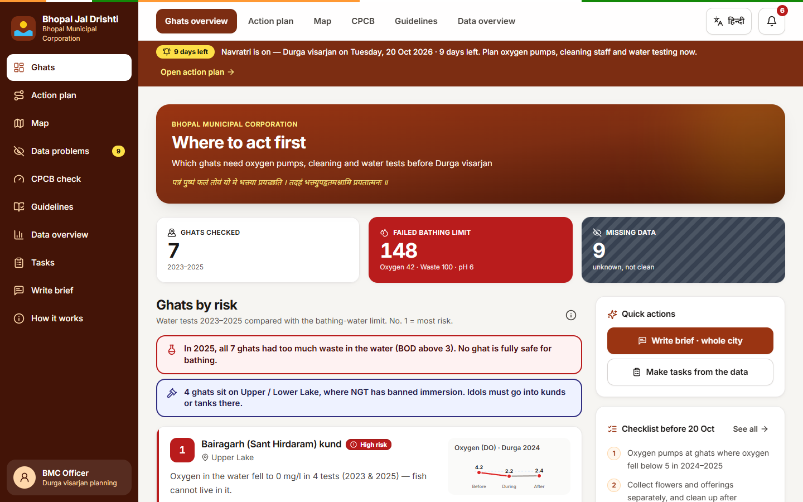
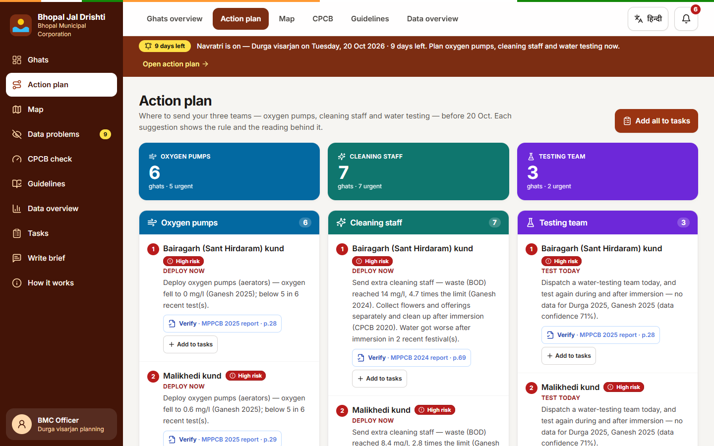
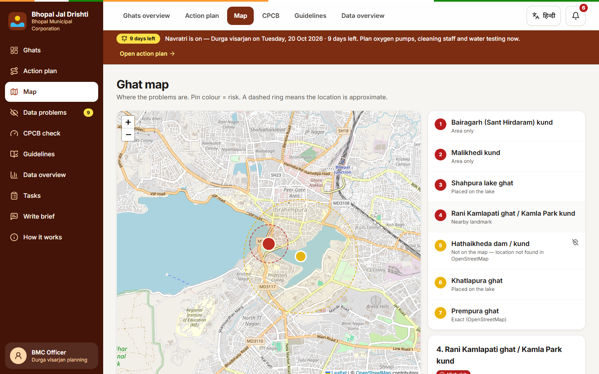
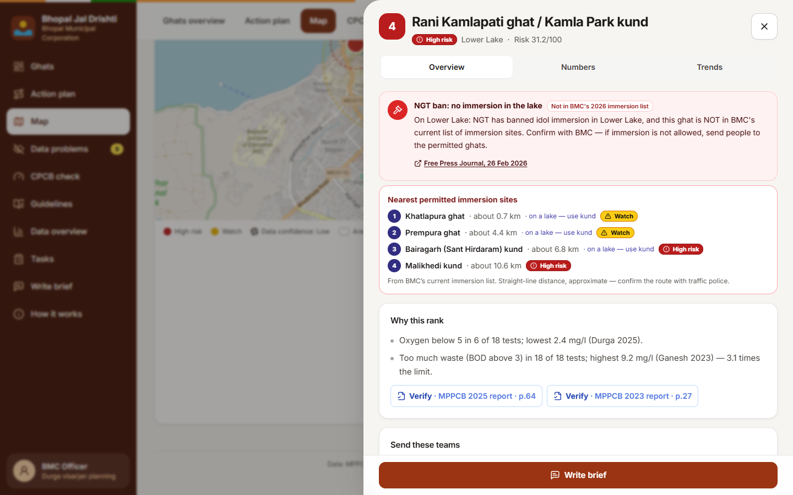
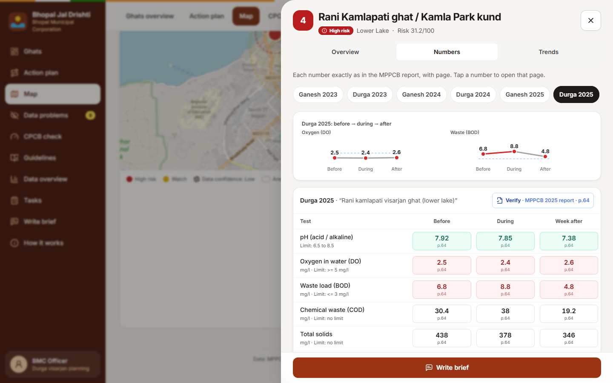
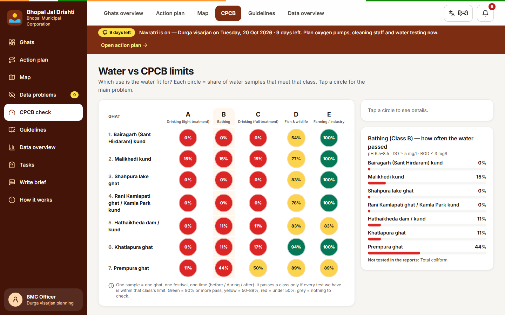
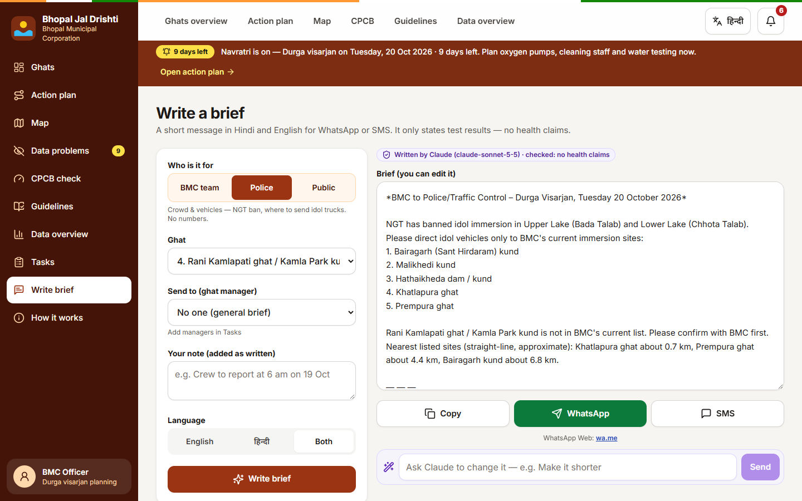
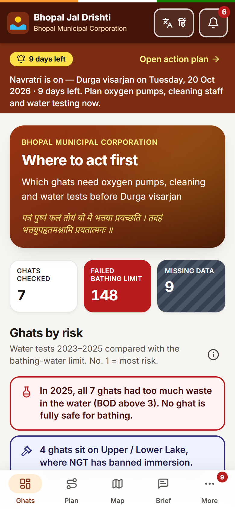
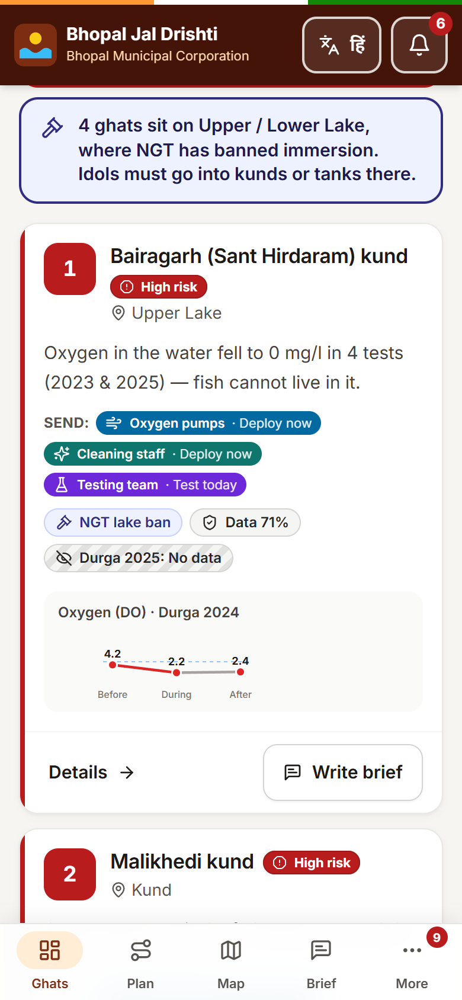
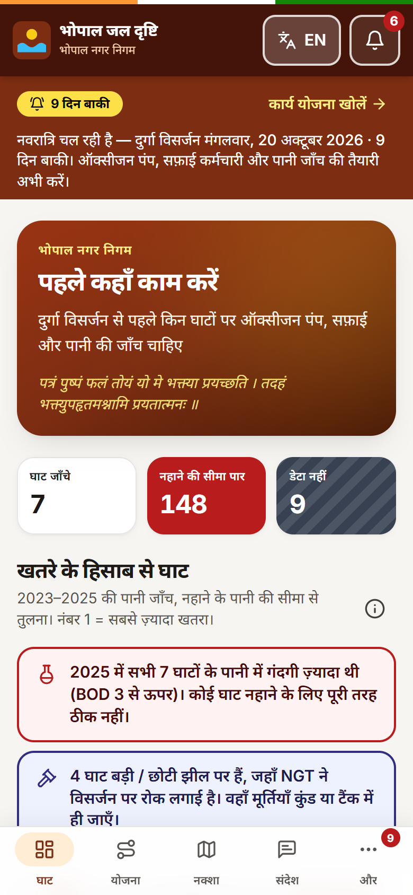

# Bhopal Jal Drishti | भोपाल जल दृष्टि

_Durga visarjan decision-support for Bhopal Municipal Corporation_

**Track:** 2 — Visarjan Ghat Watch (Bhopal Impact Lab 2026)
**Team:** Solo build — Pratham
**License:** MIT (see [`LICENSE`](LICENSE))



## The user

The **Bhopal Municipal Corporation (BMC) officer who plans Durga visarjan** (Tuesday, 20 October 2026). They use it on a phone or a desktop in the days before the festival to decide **where to send oxygen pumps (aeration), extra cleaning staff and water testing**.

## What it does

1. **Ranks the 7 Bhopal immersion ghats** (1 = highest risk) using 3 years (2023–2025) of MPPCB test readings compared with **CPCB Class B (outdoor bathing)** limits. Each rank has a plain-words reason, e.g. _"Oxygen in the water fell to 0 mg/l in 4 tests (2023 & 2025) — fish cannot live in it."_
2. **Tells the officer what to do.** The **Action plan** turns the readings into the decision the problem statement describes — which of the 3 teams to send where — with the rule and the PDF page behind every suggestion.
3. **Shows the receipts.** Every number is shown exactly as printed, with a **Verify** link that opens the MPPCB PDF at that page. **Missing data is never shown as clean.**
4. **Mobile-first and fully bilingual** — designed for a phone at the ghat first, and switchable between English and हिन्दी in one tap ([details](#mobile-first-and-accessible)).
5. **Writes forwardable briefs in Hindi and English** for three audiences (BMC team, Police, Public), with Copy, WhatsApp and SMS buttons. Claude writes them when an API key is set; a guardrail rejects any health claim, and a verified template is used offline or if a draft fails the checks.

### Resource allocation engine (Action plan)

| Team | Rule (readings from the last 2 report years) | Basis |
|---|---|---|
| Oxygen pumps | Oxygen < 4 mg/l → **Deploy now**; 4–5 mg/l → **Standby** | CPCB Class C/D minimum is 4; Class B (bathing) is 5 |
| Cleaning staff | BOD > 3 mg/l → **Deploy**; > 6 (double the limit) → **Urgent** | CPCB Class B limit is 3 |
| Testing team | Missing table / untested phase, or data confidence < 75% → **Test today** | Missing ≠ clean |
| NGT · crowd | Ghat on Upper / Lower Lake → idols into the kund, not the lake; not in BMC's list → **Divert crowds** | Free Press Journal, 26 Feb 2026 |

Current result: **oxygen pumps → 6 ghats (5 urgent) · cleaning staff → 7 · testing → 3 · NGT checks → 4**. The tool suggests; the officer decides.

> **Where do the suggestions come from?** They are **not copied from the PDFs** — the MPPCB reports contain only readings. The three team types come from the problem statement. The triggers are the CPCB limits (`data/cpcb_water_quality_criteria.csv`) applied to the MPPCB readings. Cleaning wording ("collect flowers and offerings separately, clean up after immersion") follows the CPCB 2020 idol-immersion guidelines. NGT items come from the Free Press Journal report. Tasks and ghat managers are entered by the officer.

### Pages

| Page | What the officer gets |
|---|---|
| **Ghats overview** | Navratri warning bar, key warnings (BOD, NGT), ranked ghat cards with the teams to send, data confidence, oxygen sparkline; quick actions, checklist and data problems on the side. |
| **Action plan** | Oxygen pumps / Cleaning staff / Testing columns, most urgent first, plus the NGT list. One tap adds a suggestion to Tasks. |
| **Map** | OpenStreetMap with ghats coloured by risk. Dashed ring = approximate location; dashed outline = low data confidence. Keyboard-friendly list beside it. |
| **Ghat details** | Tabs: *Overview* (NGT banner, divert-to list, why this rank, teams to send with rule + evidence), *Numbers* (all 13 tests, every festival, page-linked), *Trends* (2023 → 2025, before / during / after sparklines). |
| **Divert-to** | For the 4 lake ghats: nearest permitted sites from BMC's current list, with straight-line distance and risk (e.g. Rani Kamlapati → Khatlapura ≈ 0.7 km, Prempura ≈ 4.4 km). Marked approximate — confirm the route with traffic police. |
| **Data problems** | Missing tables, partly tested festivals, blank cells, numbers to re-check (oxygen 0, BOD jumping 10×, identical "before" and "week after" values), the Rani Kamlapati / Kamla Park name problem. Refresh button. |
| **CPCB check** | Ghat × class A–E matrix — which use the water is actually fit for. No ghat meets classes A, B or C; most meet only D (fish & wildlife) or E (irrigation). |
| **Guidelines** | NGT ban, BMC's new ghats, CPCB 2020 idol-immersion guidance, 5-point checklist — each with its source. |
| **Data overview** | Readings found, BDL vs not tested, failure rate per festival, before / during / after comparison, test coverage. |
| **Tasks** | Tasks from the data, ghat managers (name, mobile), assign, due date, status, send on WhatsApp. Saved **only on this device**. |
| **Write brief** | Audience (BMC team · Police · Public) → ghat → ghat manager → what's wrong → your note → language → write. Editable; "Ask Claude to change it" refines the draft. |
| **Alerts** | Countdown, oxygen-zero ghats, missing data, urgent tasks not assigned. |

### Mobile-first and accessible

Built for an officer standing at a ghat in direct sunlight, with weak signal, as much as for a desk.

| Feature | What it means for the officer |
|---|---|
| **Mobile-first layout** | On a phone: sticky header, bottom bar (Ghats · Plan · Map · Brief · More), detail panels that slide up from the bottom, one-column cards. On desktop the same app becomes a sidebar + top tabs + 2-column dashboard. |
| **Big touch targets** | Every button and link is at least 48 × 48 px — usable with one thumb, on the move. |
| **Readable in sunlight** | Solid, high-contrast status colours (text contrast ≥ 4.5:1, WCAG 2.1 AA). Status is always icon + word + colour, never colour alone. |
| **Works with weak signal** | The last ranking and ghat details are saved on the phone and shown offline, with an "Offline — data saved at …" note. Briefs work without internet or an API key. |
| **Screen readers & keyboard** | ARIA labels on cards, badges, charts and map pins; a list beside the map as a non-visual alternative; skip link; full keyboard use; Escape closes panels; visible focus ring. |
| **Reduced motion** | Animations switch off if the phone is set to "reduce motion". |

### Language accessibility — English ↔ हिन्दी

- **One tap switches the whole app** between English and Hindi — every page, card, chart label, alert and data problem, not just the menu. The choice is remembered.
- **Plain words, not jargon:** "Oxygen in water (DO)", "Waste load (BOD)", "Failed bathing limit", "Missing data — do not assume clean". In Hindi: "पानी में ऑक्सीजन", "गंदगी (BOD)", "ज़्यादा खतरा", "डेटा नहीं — इसे साफ़ न मानें".
- **Natural Hindi**, written for an officer, not word-for-word translation; numbers, units (mg/l) and short names (DO, BOD, pH) stay in Latin script so they match the reports.
- **Proper Devanagari fonts** (Noto Sans Devanagari) bundled in the app, so Hindi renders correctly even offline.
- **Every brief comes in both languages** (English, हिन्दी, or both together) — ready to forward on WhatsApp or SMS to staff, police and the public.

## Screenshots

**Action plan** — where to send oxygen pumps, cleaning staff and testing, with the rule and PDF page behind each suggestion


**Map** — ghats coloured by risk; dashed ring = approximate location


**Ghat details** — NGT banner, nearest permitted sites (divert-to), why this rank


**The receipts** — every reading exactly as printed, each linked to its MPPCB report page; missing shown as missing


**CPCB check** — which use the water is actually fit for (classes A–E)


**Write brief (Police)** — written by Claude, checked for health claims, ready for WhatsApp


**Mobile-first, English ↔ हिन्दी**

| Phone · English | Phone · ghat card | Phone · हिन्दी |
|---|---|---|
|  |  |  |

## Demo

The 2-minute screen recording is submitted through the event's Google Form.

## How to run (5 steps)

Requirements: Python 3.11+ and Node.js 18+.

```bash
# 1. Get the code
git clone <this-repo-url> bhopal-jal-drishti && cd bhopal-jal-drishti

# 2. (Optional) add a Claude key for AI-written briefs. Without it, the verified template brief is used.
cp .env.example backend/.env        # Windows: copy .env.example backend\.env  — then set ANTHROPIC_API_KEY

# 3. Install the backend
cd backend && python -m venv .venv && .venv/bin/pip install -r requirements.txt   # Windows: .venv\Scripts\pip install -r requirements.txt

# 4. Build the frontend
cd ../frontend && npm install && npm run build

# 5. Run (API + app on one port), then open http://localhost:8000
cd ../backend && .venv/bin/python -m uvicorn app.main:app --port 8000          # Windows: .venv\Scripts\python -m uvicorn app.main:app --port 8000
```

- **Dev mode:** run step 5, then `cd frontend && npm run dev` and open http://localhost:5173 (`/api` is proxied to port 8000).
- **Tests:** `cd backend && .venv/bin/python -m pytest -q` — 17 tests (BDL and missing-data rules, headline numbers, ranking, citations, resource rules, divert routes, CPCB matrix, brief audiences, guardrail).
- **Model:** `ANTHROPIC_MODEL` in `.env` (default `claude-sonnet-5-5`).

## How the ranking works

**Standard:** CPCB **Class B — organised outdoor bathing**: DO ≥ 5 mg/l, BOD ≤ 3 mg/l, pH 6.5–8.5. Devotees enter the water at ghats during visarjan, so the bathing standard fits best.

**Risk score (0–100)** = 40% average DO shortfall below 5 · 30% average BOD excess above 3 (capped at 4× the limit) · 15% worst DO in the last 2 years · 10% share of festivals where water got worse after immersion · 5% share of pH readings out of range. Recent years and Durga count more (latest year ×1.0, previous ×0.7, before that ×0.5; Durga ×1.0, Ganesh ×0.8).

**Colours:** red = score ≥ 40 or DO < 3 mg/l in the last 2 years · yellow = breaches below the red line · green = no recent breaches · grey = not tested. Status is always shown with an icon and a word, never colour alone.

**Data rules**
- `BDL` / `ND` → 0.001 in calculations, shown as printed, **never flagged as a risk**.
- Blank, `_`, `-`, `*`, `**`, `not sampled` → missing. **Never zero, never clean.** Missing data never lowers a score; it lowers **data confidence** (readings found ÷ readings expected: 13 tests × 6 festivals × 3 times).

**Result:** 1 Bairagarh (58) · 2 Malikhedi (37) · 3 Shahpura (37) · 4 Rani Kamlapati / Kamla Park (31) · 5 Hathaikheda (22) · 6 Khatlapura (20) · 7 Prempura (14).
Headline numbers match the track brief: **42 of 116 DO readings below 5 mg/l** and **100 of 112 BOD readings above 3 mg/l**. All 7 ghats breached the BOD limit in 2025, so no ghat is green.

## What works, what does not

**Works**
- All 1,524 Bhopal readings loaded, checked against CPCB limits, ranked, and traced to their PDF page (spot-checked against the 2023 and 2025 PDFs).
- Action plan, divert-to routing, map, three-audience briefs, tasks — on desktop and phone, in English and Hindi.
- Accessible: high-contrast colours, 48 px touch targets, ARIA labels, keyboard and Escape support, reduced-motion support.
- Works offline after first load (last data cached); briefs work with no internet or key (template).

**Does not / not covered**
- **Total coliform** (part of Class B) is not in any MPPCB visarjan table, so the tool cannot judge it and says so.
- Only 4 metals (Cr, Pb, Zn, Cu) were tested and Class B sets no limits for them — shown, not scored.
- No 2026 readings exist yet; the ranking is based on 2023–2025.
- **Map locations are approximate** except Prempura; **Hathaikheda is not on the map** (not found in OpenStreetMap — no invented coordinates). Distances are straight-line.
- Units are assumed standard units — the reports print none.
- "Rani Kamlapati ghat / Kamla Park kund" may be two places (medium match confidence) — flagged, not resolved.
- "Ask Claude to change it" can take 1–2 minutes.
- The statewide file (`mp_immersion_sites_2023_2025.csv`) is not used.

## Data used

- **Repo data** (track folder `tracks/02-visarjan-ghat-watch/`): `data/bhopal_ghats_2023_2025.csv` (main), `data/sample_bhopal_2025.csv` (`DATASET=sample`), `data/cpcb_water_quality_criteria.csv`, `data/DATA_DICTIONARY.md`.
- **Original reports** in `resources/` (for page links):
  - MPPCB Ganesh & Durga Visarjan Report 2025 — https://www.mppcb.mp.gov.in/proc/mon/Ganesh_and_Durga_visarjan_report-2025.pdf
  - MPPCB Ganesh & Durga Visarjan Report 2024 — https://www.mppcb.mp.gov.in/proc/mon/Ganesh_and_Durga_visarjan_report-2024.pdf
  - MPPCB Idol Immersion Report 2023 (CPCB format) — https://www.mppcb.mp.gov.in/proc/mon/Idol_immer._Report_23_CPCB.pdf
- **CPCB water quality criteria** — https://cpcb.gov.in/water-quality-criteria/
- **Extra data:**
  - Free Press Journal, 26 Feb 2026 — NGT ban and BMC's immersion sites: https://www.freepressjournal.in/amp/bhopal/mp-news-idol-immersion-to-shift-from-lakes-to-safer-sites-ngt-ban-pushes-bmc-to-build-4-dedicated-ghats
  - CPCB Revised Guidelines for Idol Immersion (12 May 2020), summary by India Water Portal: https://www.indiawaterportal.org/faqs/faq-on-idol-immersion-in-india-what-the-law-says-and-where-it-falls-short
  - Durga visarjan date (Tue 20 Oct 2026), Drik Panchang: https://www.drikpanchang.com/navratri/durga-puja/durga-visarjan-date-time.html?year=2026
  - Ghat locations (`data/ghat_locations.csv`) from **OpenStreetMap** (Nominatim / Overpass), © OpenStreetMap contributors, ODbL. Each row has a `precision` (exact / landmark / area / lake). Map tiles © OpenStreetMap contributors.
- No connection to any live government system. No personal data on the server (tasks and managers stay on the device).

## API

| Method | Path | Returns |
|---|---|---|
| GET | `/api/ghats/ranked` | Ranking with score, status, reasons (EN/HI), teams to send, data confidence, location, divert-to |
| GET | `/api/ghats/{site_id}` | All 13 tests for every festival and phase, with `value_as_printed`, status and source page |
| GET | `/api/plan` | Which ghats need oxygen pumps, cleaning staff, testing and NGT checks, with rules and evidence |
| GET | `/api/anomalies` | Data gaps, readings to verify, name ambiguity, scope limits, with citations |
| POST | `/api/brief/generate` | `{site_id, audience: bmc/police/public, issues?, manager?, note?, language?, instruction?, previous?}` → English, Hindi, `source` (claude / template) |
| GET | `/api/cpcb/matrix` | Ghat × CPCB class A–E compliance |
| GET | `/api/data/summary` | Coverage, failure rate per festival, before / during / after |
| GET | `/api/guidelines` | Sourced guideline points and checklist |
| GET | `/api/notifications` | Alerts |
| POST | `/api/refresh` | Re-read the CSVs |
| GET | `/api/pdf/{year}` | Original MPPCB report (for `#page=` links) |

Interactive docs at `/docs`.

## Project layout

```
backend/   FastAPI + tests
           app/data.py cleaning · app/engine.py ranking, resource engine, divert-to, anomalies
           app/insights.py CPCB matrix, summary, alerts · app/brief.py briefs + guardrail · app/guidelines.py sources
frontend/  React 18 + Vite + Tailwind + Framer Motion + TanStack Query + Leaflet
           src/views/ pages · src/components/ shell, drawer, composer · src/store.js tasks · src/i18n.jsx EN/HI
data/      track CSVs + ghat_locations.csv          resources/  MPPCB report PDFs
```
